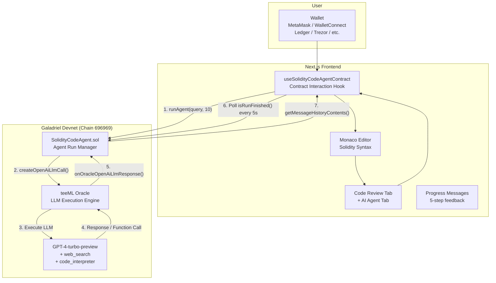
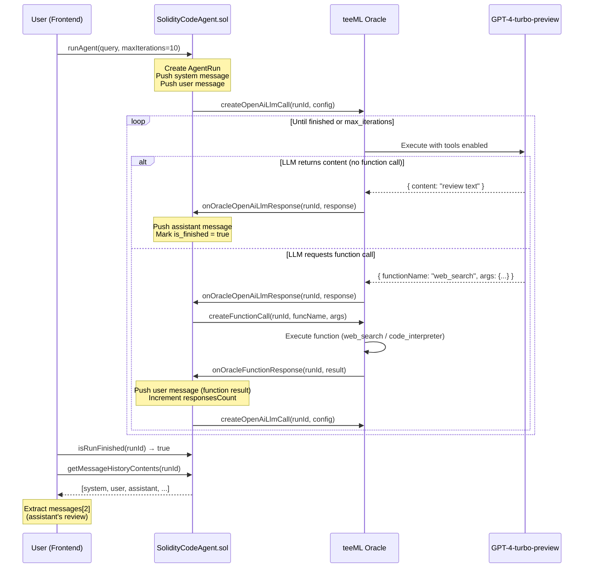
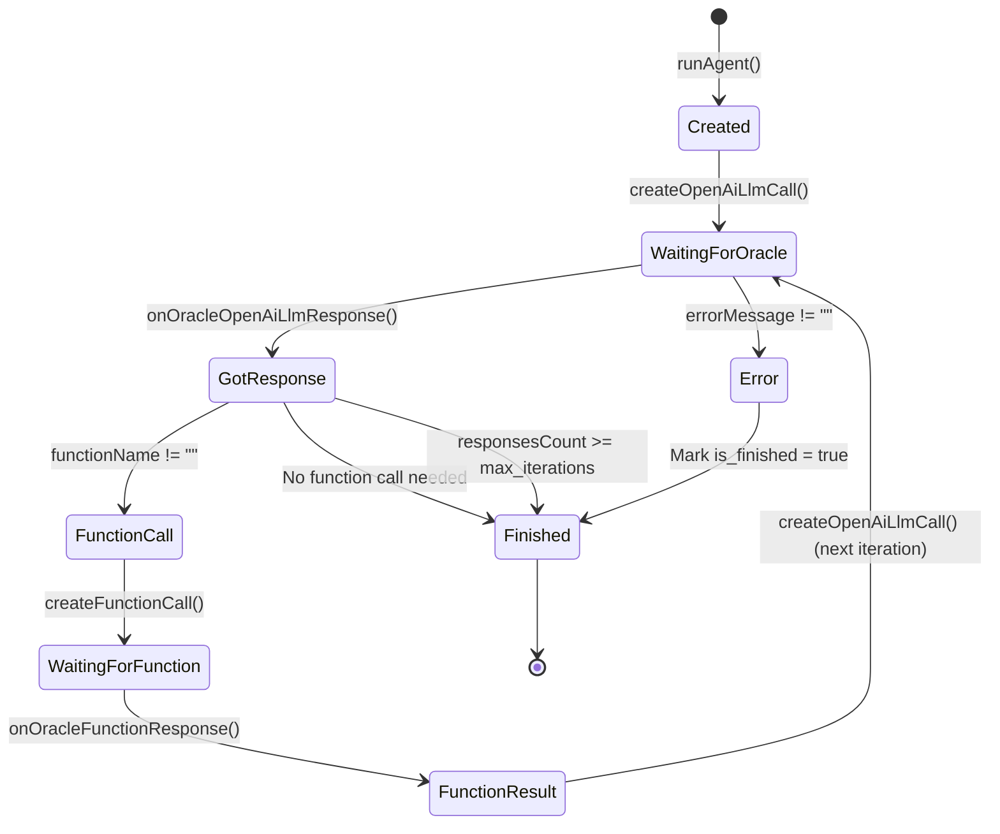
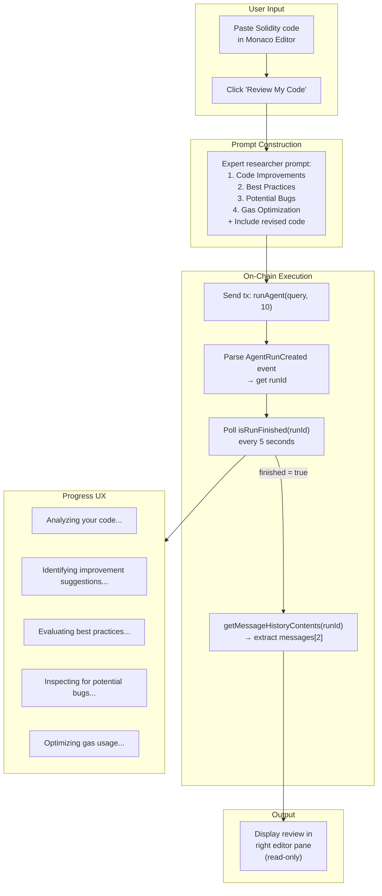
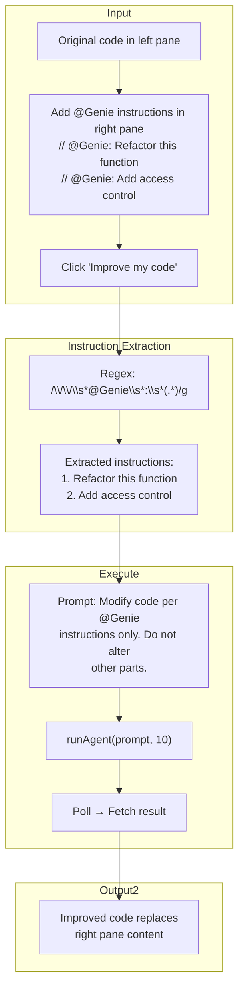
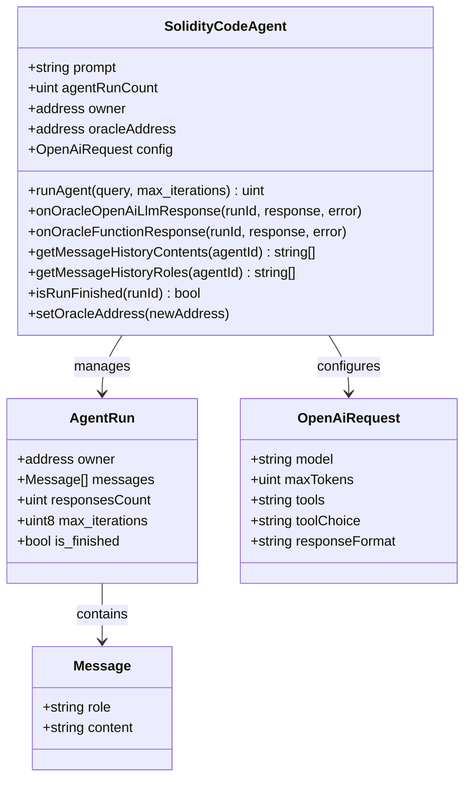
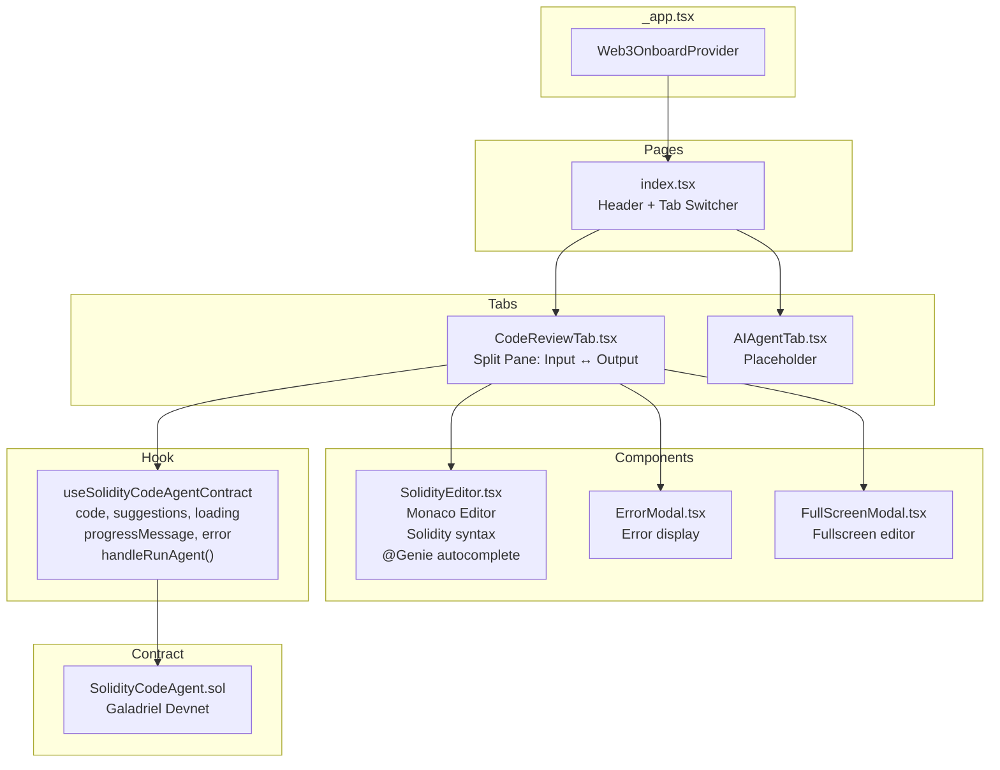

# System Design — SmartGenie

AI-powered Solidity smart contract code review platform built on Galadriel's teeML oracle. Users submit contract code, an on-chain AI agent analyzes it, and returns structured feedback covering bugs, best practices, gas optimization, and improved code.

---

## High-Level Architecture

---

## On-Chain Agent Loop

---

## Smart Contract State Machine

---

## Frontend Flow — Code Review

---

## Frontend Flow — @Genie Code Improvement

---

## Contract Data Model

---

## Component Architecture

---

## Design Decisions

| Decision | Chosen | Alternative | Reasoning |
|----------|--------|-------------|-----------|
| **AI execution** | On-chain via teeML oracle | Off-chain API call | On-chain AI is the hackathon's core theme (Galadriel). Every AI interaction is verifiable on-chain |
| **LLM model** | GPT-4-turbo-preview | GPT-3.5 / Claude | Best code analysis quality. Tools support (web_search, code_interpreter) enables richer analysis |
| **Code editor** | Monaco Editor | CodeMirror | Same editor as VS Code — Solidity syntax highlighting, autocomplete, familiar to developers |
| **Wallet integration** | Web3Onboard | RainbowKit | 7+ wallet support including hardware wallets, consistent with other projects |
| **Polling strategy** | 5-second interval | WebSocket / events | Simple and reliable. Oracle response time varies (10-60s), polling is good enough |
| **Message extraction** | `messages[2]` (3rd message) | Parse all messages | Messages are: [0]=system, [1]=user, [2]=assistant response. Index 2 is always the review |
| **@Genie instructions** | Comment-based (`// @Genie:`) | Form-based UI | Inline with code context. Developers naturally use comments. No UI overhead |
| **Max iterations** | 10 | 1-5 | Allows multiple tool calls (web_search + code_interpreter) before final response |

### What Would Change at Scale

| Current | At Scale | Why |
|---------|----------|-----|
| Polling every 5s | WebSocket or event subscription | Reduce unnecessary RPC calls |
| Single contract | Proxy + implementation pattern | Upgradeable without losing state |
| Client-side only | Backend with queue | Handle multiple concurrent reviews, rate limiting |
| No caching | Cache reviews by code hash | Same code gets same review — save gas and time |
| Galadriel devnet | Mainnet or L2 | Production reliability |

### Known Limitations

1. **Gas cost per review**: Every code review is an on-chain transaction (costs GAL tokens)
2. **Response time**: 10-60 seconds depending on oracle and LLM latency
3. **No diff view**: CodeDiffModal is a stub — can't compare before/after
4. **No history**: Previous reviews aren't saved client-side or queryable
5. **Single-chain**: Only works on Galadriel devnet (chain ID 696969)
6. **No rate limiting**: Users can spam reviews (costs gas but could congest oracle)
